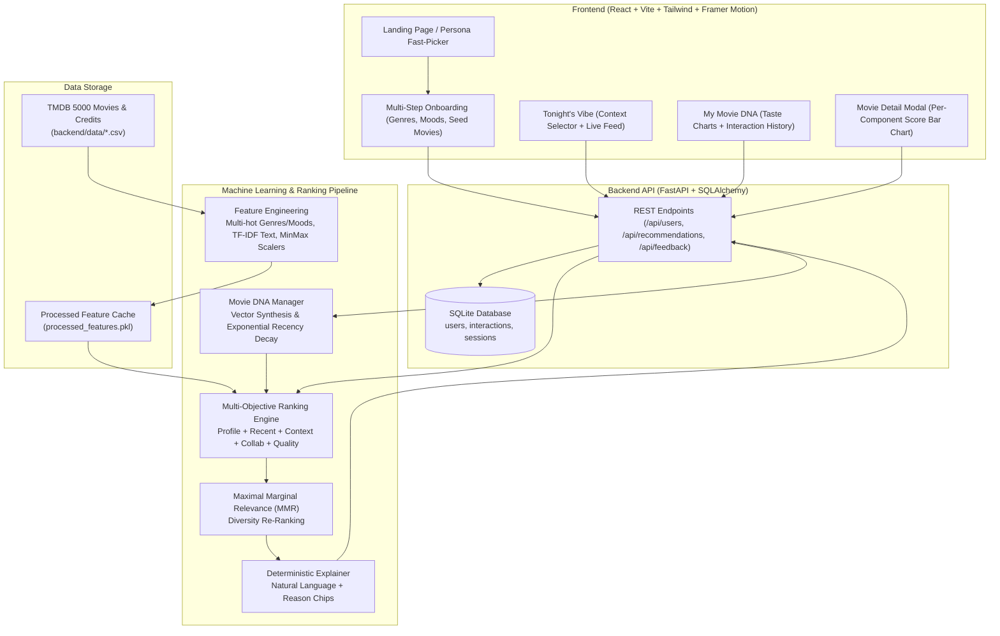

# CineMatch — Situational Movie Recommendation Engine

> **"What should THIS user watch RIGHT NOW?"**

CineMatch is a real-time, context-aware movie recommendation platform. Rather than serving static "Top 10" lists or generic catalog rows, CineMatch balances a user's persistent taste profile (**"Movie DNA"**) with their immediate situational context (available time, current mood, company, and intensity) while adapting to feedback with **exponential recency decay**.

---

## 1. System Architecture



---

## 2. Core Features & Recommendation Flow

1. **Spotify-Style Onboarding ("Movie DNA")**:
   - Collects liked anchor movies, favorite genres, preferred languages, and desired emotional moods.
   - Projects selections into a unified, L2-normalized feature vector.
2. **Situational Session Context ("Tonight's Vibe")**:
   - **Time Available**: Enforces runtime constraints with a soft buffer.
   - **Mood & Tone**: `Thoughtful`, `Feel-Good`, `Thrilling`, `Dark`, `Romantic`, `Funny`, `Inspiring`.
   - **Company**: `Solo`, `Date Night`, `Family with Kids` (filters mature/intense/crime titles), `Friends`.
   - **Intensity & Complexity**: Calibrates pacing and cognitive load.
3. **Multi-Objective Scoring**:
   $$\text{FinalScore}(m) = w_1 S_{\text{profile}}(m) + w_2 S_{\text{recent}}(m) + w_3 S_{\text{context}}(m) + w_4 S_{\text{collab}}(m) + w_5 S_{\text{quality}}(m)$$
   *(All weights configurable in `backend/config.yaml`, normalized \(0.0 - 1.0\).)*
4. **Exponential Recency Decay**:
   - Adjusts taste vectors on every interaction (`like` \(+1.0\), `dislike` \(-1.0\), `rating` \(1–5\), `watched` \(+0.6\), `skip` \(-0.4\)).
   - Formula: \( w(t) = w_0 \cdot 2^{-\frac{\Delta t}{t_{1/2}}} \) with a configurable half-life (default: 14 days).
5. **Diversity via MMR**:
   - Maximal Marginal Relevance re-ranking prevents 10 near-identical titles from dominating the top results.
6. **Transparent Explainability**:
   - Deterministic, template-based natural language explanations and structured reason chips (e.g. *"Because you liked Inception"*, *"Fits your 120m window"*).

---

## 3. Technology Stack

- **Backend**: Python 3.10+, FastAPI, SQLAlchemy (SQLite), pandas, NumPy, scikit-learn, SciPy, PyYAML.
- **Frontend**: React 19, Vite, Tailwind CSS v4, Framer Motion, Lucide Icons.
- **Data Source**: TMDB 5000 Movies and Credits CSVs (sample included in `backend/data/` for out-of-the-box execution).

---

## 4. Setup & Installation

### Prerequisites
- Python 3.10 or higher
- Node.js 18 or higher (with npm)

### 1. Backend Setup
```powershell
# In the project root:
# 1. Create and activate a virtual environment
python -m venv .venv
.\.venv\Scripts\activate

# 2. Install Python dependencies
pip install -r backend/requirements.txt

# 3. Seed the database with synthetic personas & interactions
python backend/scripts/seed.py

# 4. Start the FastAPI server
uvicorn backend.app.main:app --host 127.0.0.1 --port 8000 --reload
```
The backend API documentation is available at `http://127.0.0.1:8000/docs`.

### 2. Frontend Setup
```powershell
# In a new terminal:
cd frontend

# 1. Install dependencies
npm install

# 2. Start the Vite dev server
npm run dev -- --host 127.0.0.1 --port 5173
```
Open **`http://127.0.0.1:5173/`** in your browser.

### 3. Running Automated Tests
```powershell
# From the project root with the virtual environment active:
pytest -v
```
Runs 23 automated unit and API integration tests covering feature extraction, profile math, recency decay, context filters, ranking, and API endpoints.

---

## 5. End-to-End Demo Script

Follow this walkthrough to test the application:

1. **Explore the Landing Page**:
   - Open `http://127.0.0.1:5173/`.
   - Click one of the **Instant Evaluation Personas** (e.g., **Alex (Sci-Fi)** or **Elena (Ghibli/Animation)**) to load an active pre-calibrated taste profile.
2. **Review Movie DNA**:
   - Navigate to **"My Movie DNA"** in the top navigation bar.
   - Inspect the primary genre percentages, emotional mood signature, typical runtime, and the **Dynamic Taste Shift** banner showing the recency decay status.
   - Scroll down to review the **Recent Interaction History** log.
3. **Configure Tonight's Vibe**:
   - Click **"Tonight's Vibe"**.
   - Select:
     - **Time Available**: `90 mins` or `120 mins`.
     - **Current Mood**: `Thoughtful` or `Feel-Good`.
     - **Company**: Select `Family with Kids` (observe the live banner indicating intense/horror titles will be filtered out).
   - Click **"Find What to Watch Right Now"**.
4. **Inspect Recommendations & Reason Chips**:
   - View the ranked cards with match percentages and natural-language explanations.
   - Click **"Score Breakdown"** or tap any card to open the **Movie Detail Modal**.
   - Review the horizontal bar chart breaking down the exact weights: Profile Match, Recent Behaviour, Context Fit, Quality Prior, and Collaborative Score.
5. **Trigger Real-Time Recalibration**:
   - Dislike or skip one of the top suggestions (e.g., tap **"Dislike"** or **"Not interested"**).
   - Observe the floating toast notification and watch the movie immediately leave the feed.
   - Switch over to **"My Movie DNA"** to verify that the recent trend banner dynamically adjusted to reflect the change.
6. **Run Full Lifecycle Test via CLI**:
   ```powershell
   python backend/scripts/test_full_flow.py
   ```

---

## 6. System Design Notes & Limitations

- **Simplified Collaborative Filtering**:
  Collaborative filtering is implemented as an item-item co-occurrence model. It is intentionally kept dormant (weight = `0.0`) when overall interaction data is sparse (\(< 20\) interactions), ensuring the cold-start experience relies on verified content and context similarity rather than noisy collaborative artifacts.
- **Simplified Advanced Ranking**:
  The ranking algorithm is a linear multi-objective combination with MMR diversity rather than a black-box deep learning ranker.
- **No Accuracy Claims**:
  In accordance with research integrity standards, **no fabricated accuracy numbers, precision@k metrics, or synthetic performance benchmarks are claimed**. Feature attribution and match percentages reflect direct cosine and heuristic alignment.

---

## 7. Future Scope & Roadmap

1. **Richer Collaborative Filtering**:
   Transition from co-occurrence matrices to implicit matrix factorization (e.g., LightFM, implicit ALS, or graph neural networks) as user density scales.
2. **Group Recommendations**:
   Multi-user session mode: synthesize a temporary joint preference vector across multiple users' Movie DNA profiles with fair Pareto-optimal ranking and conflict penalty heuristics.
3. **Natural-Language Conversational Queries**:
   Allow conversational queries (e.g. *"Something like Arrival, but faster paced and suited for date night"*) translated into situational context constraints.
4. **Interactive Preference Sliders**:
   Give users direct sliders in the UI to manually adjust the ranking weights (e.g., maximize novelty vs stick strictly to favorites).
5. **Small-Group Pilot Study**:
   Conduct an empirical pilot with 20–50 users over a 4-week window to measure real-world satisfaction, session completion rates, and reduction in time-to-selection.
